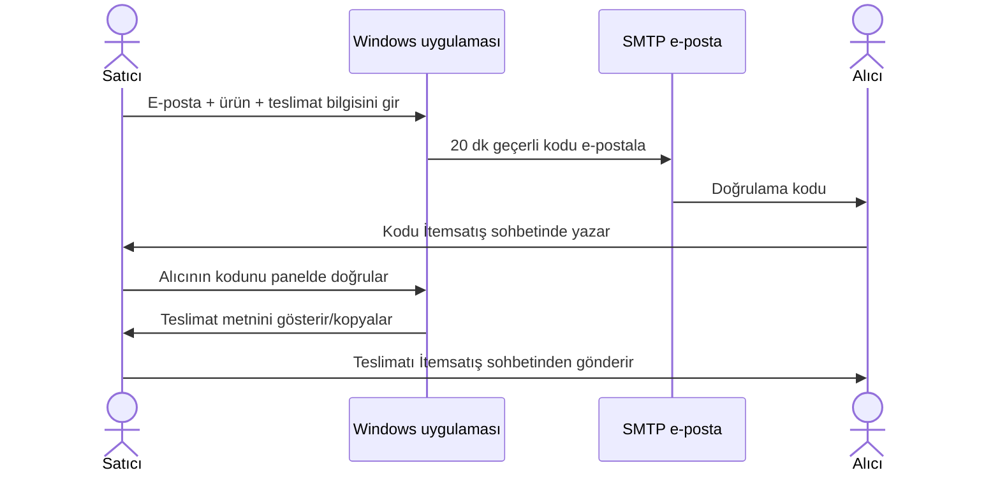

<div align="center">


# Satıcı Doğrulama

### E-posta kodu ve İtemsatış sohbetinde kontrollü teslimat

[](https://www.python.org/)
[](https://www.itemsatis.com/)
[](https://www.microsoft.com/windows)
[](LICENSE)
[](#durum-ve-sınırlar)

**Satışı siz kaydedin, alıcıya e-posta doğrulama kodu gönderin. Alıcı kodu İtemsatış sohbetinde size yazar; doğrulama sonrası teslimat metnini yine İtemsatış sohbetinden gönderin.**

</div>

> [!IMPORTANT]
> Uygulama İtemsatış sohbetini otomatik okuyup yanıtlamaz. İtemsatış'ın belgelenen webhook'u bildirimleri satıcının belirlediği URL'ye HTTP POST ile gönderir; site sohbetinde mesaj okuma/gönderme API'si belgelenmemiştir. Bu nedenle sohbet adımı satıcı tarafından yapılır. Uygulama İtemsatış tarafından yapılmamıştır ve resmi olarak desteklenmez.

## Akış



## Özellikler

- Windows masaüstü arayüzüyle sipariş kaydı ve sipariş geçmişi.
- Tekrarlanan ürünler için kaydedilebilir teslimat şablonları ve sipariş/ilan numarası alanı.
- SMTP üzerinden tasarımlı HTML kod e-postası ve uyumluluk için düz metin alternatifi (STARTTLS).
- Alıcının İtemsatış sohbetinde ilettiği kodu satıcı panelde doğrular.
- 20 dakikalık, tek kullanımlık doğrulama kodları; kodlar veritabanında SHA-256 özetiyle tutulur.
- Doğrulama başarılı olunca teslimat metni panelde açılır ve panoya kopyalanabilir; satıcı mesajı İtemsatış sohbetinde gönderir.
- SMTP parolası Windows DPAPI ile mevcut Windows kullanıcısına özel şifrelenerek tutulur.
- Siparişler cihazda SQLite veritabanına kaydedilir.

## Kurulumdan kullanıma

1. Python 3.10 veya üstünü yükleyin ve projeyi indirin.
2. Windows'ta `Baslat.bat` dosyasına çift tıklayın. Başlatıcı Python ortamını kurup uygulamayı açar. Elle başlatmak için `py app.py` komutunu kullanabilirsiniz. İlk çalıştırmada lisans anahtarınızı girmeniz gerekir.
3. **E-posta Ayarları** sekmesinden SMTP sunucusu/portu, e-posta kullanıcı adı, gönderen adresi ve uygulama şifresini kaydedin. Gmail kullanıyorsanız hesap parolanız yerine uygulama şifresi gerekir.
4. Stok kodu/ürünü satıyorsanız uygulamadaki **Kurulum bilgisini aç** bağlantısıyla İtemsatış'ın stoklu ilan otomatik teslimatını ayarlayın. Bu, platform içinde tam otomatik teslimat için önerilen yoldur.
5. Özel teslimat gereken satışlarda alıcı e-postasını, kullanıcı adını, sipariş numarasını ve ürün bilgisini girin. Satış/e-posta bilgisi bu sürümde İtemsatış'tan otomatik alınmaz. Tekrarlanan teslimat bilgileri için **Şablonu kaydet**'i kullanın. **Siparişi kaydet ve kodu gönder** düğmesine basınca uygulama kodu üretip e-postayı otomatik gönderir; alıcıya yazacağınız kod isteme mesajını da panoya kopyalar.
6. Alıcı kodu İtemsatış sohbetinden ilettiğinde kodu **İşlem Akışı** sekmesinde doğrulayın; teslimat metnini kopyalayıp aynı sohbetten gönderin.

## EXE oluşturma

EXE, Windows üzerinde oluşturulmalıdır. Python ortamını hazırladıktan sonra:

```powershell
py -m pip install -r requirements.txt pyinstaller
py -m PyInstaller --noconfirm --clean --onefile --windowed --name SaticiDogrulama --icon assets/seller-icon.ico app.py
```

Çıktı `dist/SaticiDogrulama.exe` olur. İsteğe bağlı otomatik Windows derlemesi için GitHub Actions iş akışı vardır: `v*` formatında etiket gönderildiğinde EXE paketini GitHub Release'e ekler. Release/indirilebilir dosya yayımlamak için depoya GitHub'da sahip olmanız ve etiketi göndermeniz gerekir.

EXE simgesi `assets/seller-icon.ico`, README'de görünen görsel ise `assets/seller-icon.png` dosyasıdır. Simge proje için özgün hazırlanmıştır ve `assets/ICON-LICENSE.txt` içinde açıklanan CC0 1.0 koşullarıyla telifsiz kullanıma açılmıştır.

> EXE dijital olarak imzalı değildir; Windows SmartScreen uyarısı gösterebilir. İmzalama sertifikası ayrıca edinilip yapılandırılmalıdır. Tek dosya paketleme kodu şifrelemez veya kopyalanmasını engellemez.

## Süreli lisans anahtarı verme

Uygulama Ed25519 imzalı, süre sonu olan anahtarları çevrimdışı doğrular. Lisans oluşturmak için `license_private.pem` imzalama anahtarını kendi güvenli bilgisayarınızda saklayın. Bu dosya **asla GitHub'a, EXE'ye veya müşteriye gönderilmez**; yedeğini güvenli ve erişimi sınırlı bir yerde tutun. Depoda `license_config.py` içinde sadece herkese açık doğrulama anahtarı bulunur.

PowerShell'de proje klasöründe, lisans üreticisinin çalıştığı Python ortamında:

```powershell
py -m pip install -r requirements.txt
py license_admin.py issue --customer "Müşteri veya sipariş etiketi" --days 30
```

Komutun verdiği `IS1...` anahtarını müşteriye özel kanaldan iletin. Müşteri uygulamanın ilk açılışında anahtarı etkinleştirir; sonraki açılışlarda anahtar bilgisayarda DPAPI ile saklanıp kontrol edilir. Süre dolunca yeni anahtar üretip iletin. Lisans üreticisini dağıtım paketine koymayın. Bir imzalama anahtarı kaybolursa veya açığa çıkarsa yeni anahtar çifti ve yeni EXE gerekir; eski özel anahtarı geri alamazsınız.

Bu lisans çevrimdışı ve cihaz hesabına bağlıdır; müşteri anahtarı başka bilgisayara taşıyabilir. Saat geriye alma için yerel bir kontrol vardır, fakat bu sunucu tabanlı aktivasyon veya kopyalamaya karşı tam koruma değildir. Ücretli geniş dağıtımda cihaz aktivasyonu/iptali ve yenileme için HTTPS lisans sunucusu gerekir. Kod imzası ile ürün lisansı farklı şeylerdir; imzasız EXE SmartScreen uyarısı gösterebilir.

## Veri ve güvenlik notları

- Sipariş veritabanı `%LOCALAPPDATA%\SaticiDogrulama\orders.sqlite3` konumundadır. Ürün teslimat bilgisi bu dosyada **açık metin** olarak bulunur; Windows hesabınızı ve diskinizi koruyun. Yedekleme/silme işlemlerini kendiniz yönetin.
- SMTP parolası Windows DPAPI ile bu Windows kullanıcısına özel şifrelenir; uygulama ayarlarında düz metin olarak saklanmaz. Uygulama dış servislere yalnızca e-posta gönderimi sırasında SMTP bağlantısı açar.
- Yalnızca yasal olarak satmaya ve teslim etmeye yetkili olduğunuz ürünleri kullanın. Alıcının e-posta adresini ve dijital bilgileri gerekli amaç dışında kullanmayın.
- E-posta ile kod göndermek için uygulama açık ve internet bağlantısı etkin olmalıdır. Bu sürüm yerel/tek satıcı kullanımı içindir; ekip, bulut yedekleme veya otomatik sohbet yanıtı sunmaz.
- Üretim kullanımı öncesinde SMTP sağlayıcısı, vergi/tüketici yükümlülükleri ve pazar yeri şartları satıcı tarafından kontrol edilmelidir.

## Durum ve sınırlar

Bu depo başlangıç/önizleme sürümüdür. Satıcı sipariş kaydını uygulamaya elle girer ve sohbet mesajlarını İtemsatış'ta elle gönderir. İtemsatış'ın resmi webhook'u satış/ilan sorusu gibi olayları uzak bir HTTP URL'sine bildirebilir; masaüstünde çalışan uygulama tek başına herkese açık webhook URL'si sağlamaz. Webhook ile otomatik satış tetikleme için herkese açık HTTPS sunucusu gerekir. İtemsatış'ın [webhook açıklaması](https://www.itemsatis.com/webhook-ayarlari.html) ve [üyelik/kullanım kuralları](https://www.itemsatis.com/kayit.html) incelenmelidir. Kurallarda API/script ile sitedeki veriyi çekme yasağı yer aldığından, sohbeti tarayan veya taklit eden bir entegrasyon eklenmemiştir. Uygun entegrasyon için İtemsatış'tan yazılı izin veya resmi sohbet API'si istenmelidir.

## Lisans ve marka

Kaynak kod [MIT Lisansı](LICENSE) ile sunulur; yeniden kullanım ve dağıtımda lisans bildirimi korunmalıdır. MIT, ticari kullanıma da izin verir; özel mülkiyet veya kopyalanmayı önleme garantisi vermez. `Itemsatis`/`item satış` adları ve logoları ilgili sahiplerine aittir; burada yalnızca uyumluluk amacıyla anılır. Bu proje pazar yerinin resmi ürünü değildir.

## Katkı ve güvenlik bildirimi

Hata ve özellik taleplerini GitHub Issues üzerinden açın. Güvenlik açığı bildirimlerinde token, e-posta veya gerçek sipariş bilgisi paylaşmayın; önce depoda bir iletişim adresi yapılandırılana kadar hassas ayrıntıları herkese açık issue'ya koymayın.
